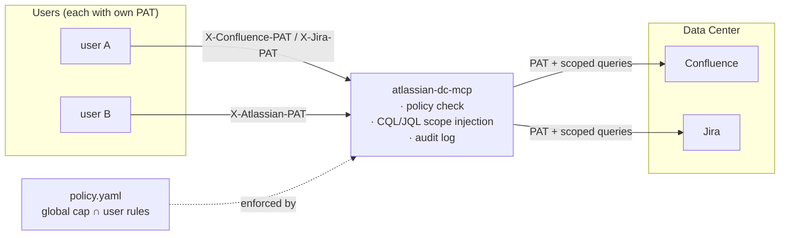
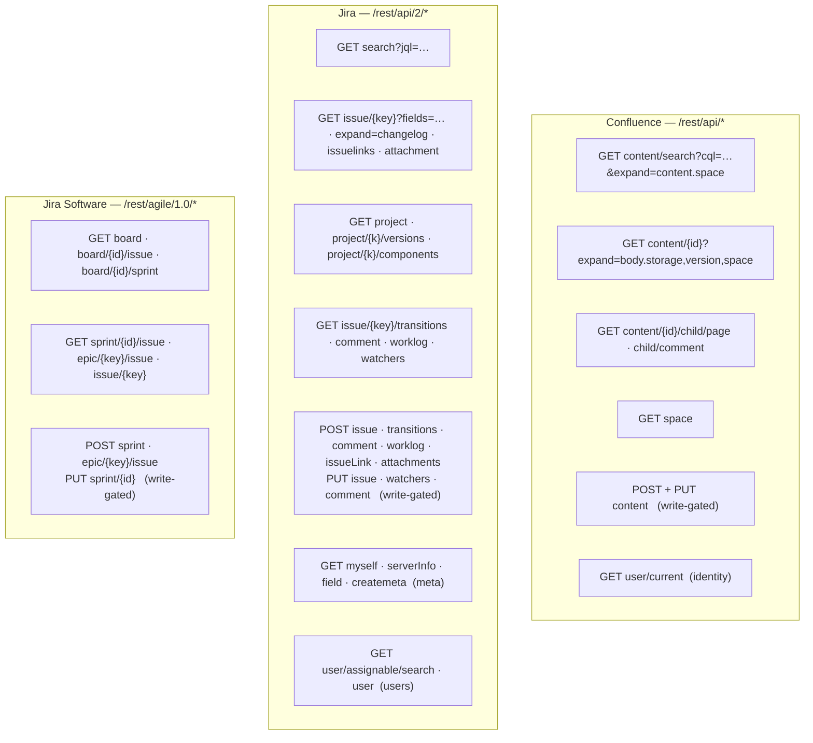

# atlassian-dc-mcp

**Docs: [whjvenyl.github.io/atlassian-dc-mcp](https://whjvenyl.github.io/atlassian-dc-mcp)**

MCP server for **self-hosted Atlassian Data Center** — Confluence and Jira —
with **per-user PAT passthrough** and a server-side **policy that caps what
each user (or everyone) can reach**.

> On **Atlassian Cloud**, use the official
> [Rovo MCP](https://github.com/atlassian/atlassian-mcp-server)
> (`https://mcp.atlassian.com/v2/mcp`) — OAuth 2.1, admin data policies,
> audit logging included. This project exists because the official server
> does not support Data Center / self-hosted instances, where auth is
> PAT-based and the policy layer has to live in the deployment.



Effective access per request = **PAT's DC permissions ∩ global cap ∩
user rules**. Layers only ever narrow — a user's PAT can never reach
outside the server policy, and the server itself stores no credentials.

## Compatibility

| | minimum | notes |
|---|---|---|
| **Confluence DC** | 7.9+ for PAT auth | PATs introduced in 7.9; on older versions use `Authorization: Basic` (basic auth — many deployments disable it). `confluence_server_info` needs 7.13+ (`/rest/api/settings/systemInfo`) |
| **Jira DC** | 8.14+ for PAT auth | PATs introduced in 8.14; same `Basic` fallback below. Agile tools need Jira Software installed (`/rest/agile/1.0` is bundled on DC 9+/11) |
| **REST endpoints used** | mostly long-stable | core calls exist since Confluence 5.x / Jira 7.x; Jira Software for `/rest/agile/1.0`; Confluence 7.13+ for `systemInfo` (fails soft); `createmeta` works on DC 8–11 (see note) |
| Node | 20+ | for npm/source installs; binaries and Docker need nothing |

Endpoints called, per product:



Identity resolution tries `user/current` (Confluence-style) then
`myself` (Jira-style) — works against either product's credential.
`createmeta` is version-tolerant: DC 11's path form
(`issue/createmeta/{project}/issuetypes/{id}`) is tried first, with the
legacy `?projectKeys=&expand=` query form as fallback for DC 8/9/10.
Every Jira endpoint above was audited against the DC 11.2.1 OpenAPI
spec. If a tool errors on an exotic version, the audit log + the tool's
error name the failing call.

---

## Which setup is yours?

| | **Local, single user** | **Team via MCPHub** | **Shared endpoint, direct** |
|---|---|---|---|
| Who | You, on your machine | Many users, one admin | Many users, one admin |
| Where PATs live | Your client config | MCPHub's encrypted vault | Each user's client config |
| User identity | You | MCPHub accounts/SSO | Resolved from the PAT itself |
| Policy | optional (`policy.yaml`) | server-side, admin-owned | server-side, admin-owned |
| Setup effort | ~2 min | admin deploys once | admin deploys + ingress |

- 👤 **Just me** → jump to [Local single-user](#local-single-user)
- 👥 **Team** → [Deploy behind MCPHub](#deploy-behind-mcphub-recommended-for-teams)
- 🤖 **Agent doing the setup** → [Let your agent set it up](#let-your-agent-set-it-up)

---

## Local single-user

### Install

```bash
# pick one:
npm install -g atlassian-dc-mcp          # needs Node 20+
npx atlassian-dc-mcp                     # no install
# or grab a standalone binary (no Node needed) from Releases:
#   atlassian-dc-mcp-{linux,darwin}-{x64,arm64}, windows-x64.exe
# or: docker run ghcr.io/<owner>/atlassian-dc-mcp
```

### Configure

```bash
export CONFLUENCE_BASE_URL=https://confluence.corp.example
export JIRA_BASE_URL=https://jira.corp.example   # either one is enough
# self-signed CA on your DC instances?
export NODE_EXTRA_CA_CERTS=/path/to/corp-ca.pem
```

`policy.yaml` in the working directory is optional for single-user use —
without it the server is uncapped and your PAT's DC permissions apply as-is.
Copy `policy.example.yaml` if you want a cap anyway.

### Connect your client

```jsonc
{
  "mcpServers": {
    "atlassian-dc": {
      "type": "http",
      "url": "http://localhost:3000/mcp",
      "headers": {
        "X-Confluence-PAT": "<your confluence PAT>",
        "X-Jira-PAT": "<your jira PAT>"
      }
    }
  }
}
```

One PAT covering both products? `X-Atlassian-PAT: <pat>` or plain
`Authorization: Bearer <pat>` works too.

Start it (`atlassian-dc-mcp`, listens on :3000), check
`curl localhost:3000/healthz`, done.

---

## Deploy behind MCPHub (recommended for teams)

[MCPHub](https://github.com/samanhappy/mcphub) already solves what this
server deliberately doesn't: user accounts/SSO, a per-user **credential
vault** (AES-256-GCM bindings), and a per-user tool-call activity log.
Put it in front and responsibilities split cleanly:

- **MCPHub** owns users and vaults each person's PAT, injecting it into
  upstream requests per call. Users bind their own PAT under
  **Credentials** — nobody else's is visible, and unbound users simply
  get a "bind credentials" instruction.
- **atlassian-dc-mcp** stays credential-free and only enforces
  `policy.yaml` — the layer MCPHub has no concept of.

Deploy the container somewhere MCPHub can reach it, mount your
`policy.yaml`, then register it in MCPHub as `streamable-http` pointing
at `http://<your-host>:3000/mcp` with credential slots
(`examples/mcphub-settings.json`):

```jsonc
"credentialTemplate": [
  { "target": "headers", "name": "X-Confluence-PAT", "label": "Confluence PAT" },
  { "target": "headers", "name": "X-Jira-PAT",       "label": "Jira PAT" }
]
```

One PAT covering both products → a single `X-Atlassian-PAT` slot.
Precedence per service: `X-<service>-PAT` > `X-Atlassian-PAT` > `Authorization`.

Result: two enforcement layers, neither holding the other's secrets —
MCPHub's activity log answers *who called what*, our policy + audit log
answers *what they were allowed to reach*.

## Shared endpoint, direct (no MCPHub)

Works too: terminate TLS at your ingress (PATs transit in headers — TLS
is **not optional** in a real deployment), each user configures their own
PAT in their MCP client as in the local example, and per-user policy
rules still apply because identity is resolved from the PAT
(`/rest/api/user/current`, cached 5 min) — never from a spoofable header.

```bash
docker run -p 3000:3000 \
  -e CONFLUENCE_BASE_URL=https://confluence.corp.example \
  -e JIRA_BASE_URL=https://jira.corp.example \
  -v "$PWD/policy.yaml:/app/policy.yaml:ro" \
  -v "$PWD/corp-ca.pem:/etc/ssl/corp-ca.pem:ro" \
  -e NODE_EXTRA_CA_CERTS=/etc/ssl/corp-ca.pem \
  ghcr.io/<owner>/atlassian-dc-mcp:latest
```

`GET /healthz` for liveness. Stateless — scale freely.

---

## Policy

`POLICY_PATH` (default `./policy.yaml`), hot-reloaded on change.
See `policy.example.yaml` for the full commented version.

```yaml
global:
  confluence:
    allowedSpaces: ["TEAM", "DOC"]   # hard cap, applies to EVERYONE
    # readOnly: true               # deny confluence_* writes for all
  jira:
    allowedProjects: ["SUP", "PLAT"]
  allowWrites: false                 # writes globally off by default

defaults:                            # callers with no entry under users:
  confluence: { spaces: ["TEAM"] }
  jira:      { projects: ["SUP"] }

users:                               # Atlassian usernames, resolved
  alice:                             # from the caller's PAT
    confluence: { spaces: ["TEAM", "DOC"] }
    jira:      { projects: ["SUP", "PLAT"] }
```

Semantics:

- `allowedSpaces`/`allowedProjects` unset → no cap at that layer
- user/default lists are **intersected** with the global cap — a user
  rule naming a space outside the cap gets nothing (fail closed)
- identity can't be resolved → `defaults` apply; no `defaults` → global
  cap only
- `allowWrites: false` or `readOnly` → write tools stay visible but
  refuse with an explanatory error
- empty/missing policy file → uncapped (PAT's DC permissions still apply)

## Tools

| tool | enforcement |
|---|---|
| `confluence_search` | allowlist AND-ed into CQL; `spacesFilter` intersected |
| `confluence_get_page` | page's space checked; by ID or title+space |
| `confluence_get_page_children` | children filtered by space |
| `confluence_get_page_history` | page's space checked |
| `confluence_get_labels` | page's space checked |
| `confluence_get_attachments` | page's space checked |
| `confluence_get_attachment` | owning space checked |
| `confluence_get_ancestors` | page's space checked |
| `confluence_get_blog_posts` | space checked |
| `confluence_get_comments` | parent page's space checked; footer/inline + replies |
| `confluence_get_inline_comments` | page's space checked |
| `confluence_list_spaces` | filtered to effective scope |
| `confluence_get_space_detail` | space checked |
| `confluence_get_space_content` | space checked |
| `confluence_current_user` | PAT identity |
| `confluence_search_users` | read |
| `confluence_create_page` | write-gated + space checked |
| `confluence_update_page` | write-gated + space checked, auto-bumps version |
| `confluence_delete_page` | write-gated + space checked (trash) |
| `confluence_move_page` | write-gated + both spaces checked |
| `confluence_copy_page` | write-gated + space checked |
| `confluence_add_label` | write-gated + content's space checked |
| `confluence_add_comment` | write-gated + space checked |
| `confluence_add_attachment` | write-gated + space checked; path on MCP host |
| `confluence_create_blog_post` | write-gated + space checked |
| `confluence_reply_to_comment` | write-gated + comment's space checked |
| `confluence_add_inline_comment` | write-gated + space checked; anchors to text |
| `confluence_get_page_restrictions` | page's space checked |
| `confluence_update_page_restrictions` | write-gated + space checked |
| `jira_search` | allowlist AND-ed into JQL; `projectsFilter` param intersected too |
| `jira_search_fields` | read |
| `jira_get_project_issue_types` | project checked |
| `jira_get_create_fields` | project checked |
| `jira_get_field_options` | project checked |
| `jira_get_issue` | issue's project checked post-fetch |
| `jira_get_comments` | issue's project checked |
| `jira_get_changelog` | issue's project checked |
| `jira_get_issue_links` | issue's project checked |
| `jira_get_attachments` | issue's project checked |
| `jira_download_attachment` | attachment verified against issue |
| `jira_server_info` | unscoped instance metadata |
| `jira_get_project_versions` | project checked |
| `jira_get_project_components` | project checked |
| `jira_get_agile_boards` | unscoped list |
| `jira_get_board_issues` | board project + post-filter |
| `jira_get_sprints_from_board` | board project checked |
| `jira_get_sprint_issues` | issues post-filtered |
| `jira_get_issue_agile` | issue's project checked |
| `jira_get_epic_issues` | epic project + post-filter |
| `jira_get_transitions` | issue's project checked |
| `jira_get_worklogs` | issue's project checked |
| `jira_list_projects` | filtered to effective scope |
| `jira_myself` | PAT identity |
| `jira_search_assignable_users` | project checked |
| `jira_create_issue` | write-gated + project checked |
| `jira_update_issue` | write-gated + project checked |
| `jira_assign_issue` | write-gated + project checked |
| `jira_transition_issue` | write-gated + project checked, transition by name or ID |
| `jira_add_comment` | write-gated + project checked |
| `jira_edit_comment` | write-gated + project checked |
| `jira_add_worklog` | write-gated + project checked |
| `jira_create_issue_link` | write-gated + both projects checked |
| `jira_delete_issue_link` | write-gated + project checked |
| `jira_create_version` | write-gated + project checked |
| `jira_add_attachment` | write-gated + project checked; path on MCP host |
| `jira_delete_attachment` | write-gated + ownership verified |
| `jira_create_sprint` | write-gated + board project checked |
| `jira_update_sprint` | write-gated |
| `jira_move_issues_to_epic` | write-gated + all projects checked |

Full parameters: **[docs site](https://whjvenyl.github.io/atlassian-dc-mcp/tools)** —
[Jira](https://whjvenyl.github.io/atlassian-dc-mcp/tools/jira-issues-transitions) ·
[Confluence](https://whjvenyl.github.io/atlassian-dc-mcp/tools/confluence-pages) — full page lifecycle, comments, restrictions.

Every call emits one JSON audit line on stderr (`tool`, resolved `user`,
`denied`, `ms`) — pipe it to your log collector. Credentials never logged.

## Configuration

| env | default | meaning |
|---|---|---|
| `CONFLUENCE_BASE_URL` | — | e.g. `https://confluence.corp.example` |
| `JIRA_BASE_URL` | — | at least one URL required |
| `PORT` | `3000` | listen port |
| `POLICY_PATH` | `./policy.yaml` | policy file, hot-reloaded |
| `ENABLED_TOOLS` | — | comma-separated tool allowlist; unset = all tools |
| `TOOLSETS` | — | tool groups: `default`, `all`, or names (e.g. `jira_issues,confluence_pages`) |
| `NODE_EXTRA_CA_CERTS` | — | extra CA bundle for self-signed DC certs |

## Let your agent set it up

Paste this into any capable coding agent:

```
Set up atlassian-dc-mcp for me (repo: https://github.com/whjvenyl/atlassian-dc-mcp).
1. Install: download the standalone binary for my OS from the latest
   GitHub Release, or npm install -g / npx if Node 20+ is present.
2. Ask me for CONFLUENCE_BASE_URL and/or JIRA_BASE_URL (my DC instance
   URLs) and export them; for a self-signed CA ask for the CA path and
   set NODE_EXTRA_CA_CERTS.
3. Write a minimal policy.yaml next to it (my allowed Confluence spaces /
   Jira projects — ask me which), or skip it for uncapped single-user use.
4. Ask me for my Confluence/Jira PATs (create at
   <base>/secure/ViewProfile.jspa → Personal Access Tokens) and wire my
   MCP client config to http://localhost:3000/mcp with headers
   X-Confluence-PAT / X-Jira-PAT.
5. Start the server, verify /healthz returns {"ok":true}, then run an MCP
   tools/list to confirm my tools appear.
```

Deploying the team variant instead? Tell the agent to follow the
[MCPHub section](#deploy-behind-mcphub-recommended-for-teams) — the same
prompt works, with step 4 becoming "register the server in MCPHub with
the credential slots from `examples/mcphub-settings.json`".

## For maintainers: releasing

<details>
<summary>How releases work (repo maintainers only — users don't need this)</summary>

Releases are driven by
[release-please](https://github.com/googleapis/release-please-action):

- **`release-please.yml`** — conventional commits on `main`
  (`feat:` / `fix:` / `chore:` …) open a **Release PR** that bumps
  `package.json` + `CHANGELOG.md`; merging it creates the tag + GitHub
  Release and calls `publish.yml` with the tag.
- **`publish.yml`** (`workflow_call` + `workflow_dispatch`) — checks out
  the tag, builds, publishes to npm via trusted publishing, builds the
  5-platform binary matrix, and attaches binaries + `SHA256SUMS` to the
  Release. Can be re-run manually for any tag.
- **`docker.yml`** — pushes `ghcr.io/<owner>/atlassian-dc-mcp:<version>`
  on the same tag.

**npm auth — trusted publishing only.** npm deprecated automation tokens
and granular tokens die with `EOTP` under publish-2FA, so no credential
is stored at all: publish the first version locally once (`npm login` +
`npm publish`), then on npmjs.com set the trusted publisher to this repo
+ `publish.yml`, and set repo variable `NPM_TRUSTED_PUBLISHING=true`.
From then on every Release-PR merge publishes via GitHub OIDC. Without
the variable the npm step skips and the tag still produces the Release +
binaries + GHCR image — re-run `publish.yml` manually once configured.

</details>

## Security model, in one breath

- Server holds **zero** secrets — every request carries its own PAT.
- DC still enforces the PAT's real permissions; policy only subtracts.
- Policy reload is atomic per request; malformed YAML keeps the last good
  policy.
- `policy.yaml` is gitignored — it belongs to the deployment, not the repo.
- Agent clients see the scope model in the server `instructions` and are
  told not to retry-denied calls to work around the policy.

See [SECURITY.md](SECURITY.md) for reporting a vulnerability and
[CHANGELOG.md](CHANGELOG.md) for release history.
